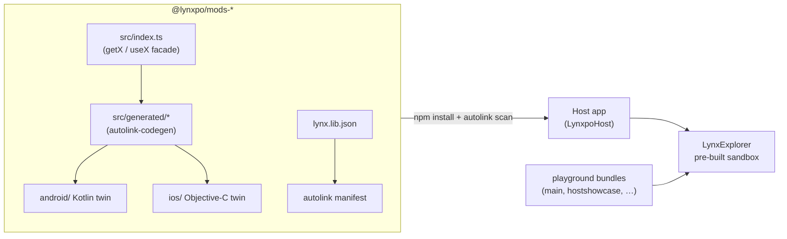

<div align="center">
  
  <p>
    <strong>Expo's native API surface for Lynx, as 66 twin-native modules you can autolink into any React-Lynx app.</strong><br/>
    Every capability ships as a real native module — Kotlin on Android, Objective-C on iOS — wrapped by a typed React-Lynx facade and declared to hosts through a <code>lynx.lib.json</code> autolink manifest.
    Built for Lynx developers who want Expo-style device APIs (camera, sqlite, secure-store, contacts, …) without leaving the Lynx toolchain.
    All 66 modules are exercised on real hardware by the bundled playground, and CI builds, pack-audits and tests every one of them.
  </p>
  <p>
    <a href="https://github.com/elcoosp/lynxpo/actions/workflows/ci.yml"></a>
    <a href="LICENSE"></a>
    <a href="https://github.com/elcoosp/lynxpo/blob/main/package.json"></a>
    <a href="https://github.com/elcoosp/lynxpo/tree/main/packages/modules"></a>
    <a href="https://github.com/elcoosp/lynxpo/tree/main/packages/modules"></a>
  </p>
</div>

</div>

<p align="center">
  <a href="#quickstart">Quickstart</a> •
  <a href="#why-lynxpo">Why</a> •
  <a href="#how-it-works">How it works</a> •
  <a href="#usage">Usage</a> •
  <a href="#status">Status</a>
</p>

## Quickstart

Requires Node.js `>=20.19` and pnpm `12.16.1` (`corepack` picks it up from `packageManager`). A pre-built [LynxExplorer](https://lynxjs.org/guide/start/quick-start.html) is the fastest way to see results — no native toolchain needed.

```bash
pnpm install
pnpm build
pnpm --filter @lynxpo/playground dev
```

`pnpm build` compiles all 67 workspace projects (66 modules + playground) in about two minutes:

```text
Tasks:    67 successful, 67 total
Time:     1m47.4s
```

`pnpm dev` starts the rspeedy dev server on port **3100**, prints a QR code, and serves a bundle per playground entry:

```text
Rspeedy v0.18.4 (Rsbuild v2.2.9, Rspack v2.2.9)

  ➜  Lynx      http://192.168.1.10:3100/main.lynx.bundle
  ➜  Lynx      http://192.168.1.10:3100/hostshowcase.lynx.bundle

main
  default: http://192.168.1.10:3100/main.lynx.bundle?fullscreen=true&enable_napi_addon=true
```

Scan the QR code with LynxExplorer (or paste the URL). The `?fullscreen=true&enable_napi_addon=true` schema is added automatically.

> [!IMPORTANT]
> `enable_napi_addon=true` makes the iOS launcher start the background Node-API runtime that loads the native modules. Without it, iOS renders every module value as `—`; Android enables the addon by default.

<details>
<summary>Install LynxExplorer (pre-built, no native toolchain)</summary>

- **iOS Simulator**: download `LynxExplorer-arm64.app.tar.gz` from the [Lynx releases](https://github.com/lynx-family/lynx/releases), then `mkdir -p LynxExplorer-arm64.app && tar -zxf LynxExplorer-arm64.app.tar.gz -C LynxExplorer-arm64.app` and drag the `.app` into the Simulator.
- **Android**: install the pre-built APK from the same release page.
- **HarmonyOS**: `hdc install lynx_explorer-default-unsigned.hap`.

Keep Explorer, pods and Maven artifacts on the same minor (4.2.0): bundles must match the host engine version.
</details>

## Why lynxpo

Lynx renders React-Lynx on a dual-threaded engine, and Expo's native modules are built for the React-Native bridge — so neither is available to a Lynx app out of the box. lynxpo re-implements that API surface as real Lynx native modules: Kotlin on Android, Objective-C on iOS, one npm package per capability under `@lynxpo/mods-*`, and a live playground that exercises each one in LynxExplorer.

- **66 modules, Expo-shaped APIs** — `@lynxpo/mods-camera`, `@lynxpo/mods-sqlite`, `@lynxpo/mods-secure-store`, … covering device, media, storage, identity, communication and user-data surfaces (see [the full list](https://github.com/elcoosp/lynxpo/tree/main/packages/modules)).
- **Twin-native, not stubs** — every module carries a Kotlin and an Objective-C implementation; iOS-only capabilities (Sign in with Apple, Live Photos) report honestly on Android instead of faking data.
- **Autolink-ready** — hosts discover modules by scanning installed npm packages for `lynx.lib.json` (the official `cocoapods-lynx-library` gem and `org.lynxsdk.lynx.library-build` Gradle plugin); no install-time copy step.
- **Typed React-Lynx facades** — each export comes as a `getX` / `useX` pair; async methods return `{ value, loading, error }` from the hook.
- **Verified end to end** — 843 vitest tests cover registry↔facade contracts, packaging metadata, permission data and the built bundles; CI pack-audits every module with `npm pack --dry-run`.
- **Official toolchain only** — `@lynx-js/rspeedy`, `@lynx-js/autolink-codegen`, rslib, Turborepo, Biome. No vendored engine tree.

The playground also ships custom LynxUI native views that mirror Expo UI surfaces, registered in the in-repo host app:

| Tag                 | Ported from          | Backing                                             |
| ------------------- | -------------------- | --------------------------------------------------- |
| `<linear-gradient>` | expo-linear-gradient | `CAGradientLayer`                                   |
| `<blur-view>`       | expo-blur            | `UIVisualEffectView` (Core-Image gaussian fallback) |
| `<symbols>`         | expo-symbols         | SF Symbols via `UIImage(systemName:)`               |
| `<mesh-gradient>`   | expo-mesh-gradient   | `MeshGradient` (iOS 18+) or static fallback         |
| `<glass-effect>`    | expo-glass-effect    | `UIGlassEffect` (iOS 26) or thin material           |
| `<video>`           | expo-video           | `AVPlayerLayer`                                     |
| `<gl-view>`         | expo-gl              | Metal-backed `CAMetalLayer` (animated)              |
| `<camera-view>`     | expo-camera          | `AVCaptureVideoPreviewLayer`                        |
| `<lynxpo-dom>`      | expo-dom             | `WKWebView` DOM surface                             |

…plus `<image>`, `<checkbox>`, `<ui-button>` and `<widget-card>`; all registered by [LynxpoHost](packages/playground/src/host/LynxpoHost).

## How it works

Each `packages/modules/<name>` is a twin-native package: a React-Lynx facade in `src/index.ts`, generated bindings in `src/generated/`, and the Kotlin + Objective-C twins under `android/` and `ios/`.



TS bindings and native specs are generated by `@lynx-js/autolink-codegen` from `types/index.d.ts`; `pnpm check:codegen` verifies the checked-in files never drift from the generator. The playground builds six entry points (`main`, `hostshowcase`, `hostdemo`, `hostmin`, `hostsingle`, `hostsync`), each exercising a different slice of the surface — `hostshowcase` lists every module and method with on-device invocation.

## Usage

Every module exposes a paired `getX` / `useX` accessor per native method. For async methods the generated hook returns `{ value, loading, error }`; for sync getters it returns the raw value:

```tsx
import { useCameraPermissionsAsync, getStartCamera } from '@lynxpo/mods-camera';

function Demo() {
  const { value, loading, error } = useCameraPermissionsAsync();
  return <text>{value?.status ?? '—'}</text>;
}
```

Run it live with `pnpm --filter @lynxpo/playground dev` and open the bundle in LynxExplorer. See [`packages/playground/src/mods/`](packages/playground/src/mods) for one demo page per module.

### Adding a module

1. Scaffold `packages/modules/<name>` with the twin-native layout above.
2. Implement the Kotlin and Objective-C modules; describe the surface in `lynx.lib.json` and `types/index.d.ts`.
3. Run `npx lynx-autolink-codegen` to generate the bindings, then write the facade in `src/index.ts`.
4. Add a demo entry to the playground and a methods entry to [`packages/playground/src/mods-registry.ts`](packages/playground/src/mods-registry.ts) (the facade tests enforce both).
5. Exercise it in LynxExplorer; hosts pick up the twins through autolink.

> [!TIP]
> If the module needs a permission, add it to `packages/playground/perms-doc/perms.json` and reference it via `NativeModules.NativePermissionsModule.requestPermission("<literal>")` — the `android-permissions` build plugin detects the call and injects the `<uses-permission>` entry into the generated `AndroidManifest.xml`.

### Command mapping (former `lynxpo` CLI)

The legacy `lynxpo` DX CLI has been removed in favour of the official Lynx tooling:

| Was                    | Now                                                                                                                   |
| ---------------------- | --------------------------------------------------------------------------------------------------------------------- |
| `lynxpo perms`         | Data is frozen under [`docs/permissions/`](docs/permissions/README.md); no regeneration step exists                   |
| `lynxpo types`         | `npx lynx-autolink-codegen` inside a module (reads `lynx.lib.json` + `types/`)                                        |
| `lynxpo build`         | `pnpm build` (turbo → rslib/rspeedy)                                                                                  |
| `lynxpo inject`        | Nothing — autolink reads `node_modules`                                                                               |
| `lynxpo ios`/`android` | `pnpm dev` → scan the QR with pre-built LynxExplorer ([quick start](https://lynxjs.org/guide/start/quick-start.html)) |
| `lynxpo doctor`        | Removed with the vendored engine tree                                                                                 |

For in-repo host testing: `pnpm host:ios` builds LynxpoHost with the freshly copied `hostshowcase` bundle (`pnpm host:bundle:copy`); `pnpm check:native:android` and `pnpm check:native:ios` run the native builds CI uses.

## Status

> [!NOTE]
> Pre-1.0 and moving fast: modules are at `0.1.0`, npm publishing is wired through [changesets](.changeset/config.json) and runs on every `main` push, but no version has been published yet. CI builds and tests on Node 24 (Linux), Gradle/Java 21 (Android) and Xcode/CocoaPods (macOS, iOS 12+).

Supported platform matrix comes straight from CI: Android (Gradle, Kotlin twins) and iOS (CocoaPods, Objective-C twins, iOS 12.0+ in every podspec). The Android core additionally exposes status-bar, clipboard, device and network utilities used by the twins.

TypeScript is pinned to `6.0.x`: Rspeedy `0.18` supports `5.1.6 – 6.0.x`, and TypeScript 7's native compiler no longer exposes the compiler API Rspeedy uses at build time.

Questions and issues: [open an issue](https://github.com/elcoosp/lynxpo/issues).

## Learn more

- [Playground](packages/playground) — the React-Lynx app that demos every module
- [`docs/permissions/`](docs/permissions/README.md) — frozen Android/Apple permission reference data
- [Lynx documentation](https://lynxjs.org) and the [LynxExplorer quick start](https://lynxjs.org/guide/start/quick-start.html)
- [Expo modules](https://docs.expo.dev/modules/) — the API surface being ported
